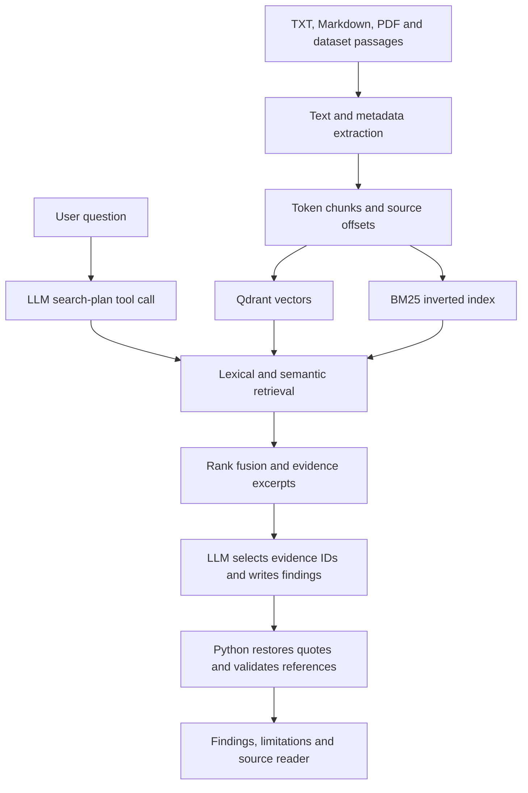

# Trace — AI Investigation Engine

Trace investigates questions across a document corpus and uploaded files. It combines lexical and vector retrieval, asks an LLM to plan searches, and returns findings linked to original evidence. It can report missing evidence or unresolved contradictions.

**Status:** source published at [Saba-Davitashvili/AI-investigation](https://github.com/Saba-Davitashvili/AI-investigation). GitHub Actions passed the offline suite on Python 3.13. The public demo URL and hosted restart verification remain pending. This repository is a working local prototype with deployment candidates; it is not proof of completed hosting.

| Submission item | Location / status |
|---|---|
| Full source | This repository; preserve the original local Git history when publishing |
| Public demo | Not yet provisioned; see docs/DEPLOYMENT.md |
| Architecture and setup | This README |
| Evaluation methodology, results and failures | EVALUATION_REPORT.md |
| AI assistance disclosure | AI_USAGE_REPORT.md |
| Remaining acceptance steps | SUBMISSION_CHECKLIST.md |

## Recorded scale and quality

The user's completed local ingestion reported **50,001 unique source passages and 60,822 fixed-token chunks**. The source archive does not contain those large runtime files; reproduce them with the ingestion commands below or retain the existing data/index directories.

The attached historical answer run contains 40 graded questions, 23 judge-correct answers (**57.5%**), 26/30 supported findings (**86.7%**, LLM judged), and 51/51 exact quote references. Zero unresolved cases remained after resumption; provider quota interruptions occurred during the run. Exact quote validity is not semantic citation correctness.

The closeout candidate changes packaging, imports and access protection. Its real-corpus/LLM evaluation has not been rerun. Original results remain unchanged in reports/answers_34a5f61598d5ab6c.json.

## Architecture



- **Python/FastAPI:** typed HTTP endpoints, upload handling and provider-error mapping.
- **Embeddings:** sentence-transformers/all-MiniLM-L6-v2, running on CPU. Questions and chunks use the same model name and normalized vectors.
- **Qdrant local mode:** persisted vectors without a separate server. A single API worker owns the local index. This simplifies a prototype, but Qdrant local mode warns above 20,000 points; server mode is a future scaling improvement.
- **Own BM25 implementation:** corpus statistics and postings are built once at startup. Query terms score their matching postings. Scores account for term rarity, frequency saturation and document length.
- **Own reciprocal rank fusion:** sums 1/(60 + rank) across ranked lists. Corpus/upload lexical lists are fused before being combined with semantic ranking. Original corpus-only evaluation is therefore not a direct measurement of the combined upload-aware endpoint.
- **SQLite:** original upload bytes, extracted text, metadata, stable IDs, timestamps and versions. Identical bytes are deduplicated even if renamed.
- **Vanilla HTML/CSS/JavaScript:** no frontend build step. Document content is rendered as text, not interpreted as HTML.
- **Groq:** native tool calling and answer generation through the configured model, default openai/gpt-oss-120b. The key stays on the server.

## Investigation and reliability

1. The model makes one native search_sources call containing 1–3 focused queries.
2. Python validates the tool name and arguments, then retrieves up to three passages per query.
3. Duplicate chunk IDs are removed. Each source receives an S-number and deterministic excerpt IDs.
4. A separate answer-generation prompt receives the evidence and selects excerpt IDs. It does not retain the planning instruction to call a tool.
5. Python copies original quote text from selected IDs and validates the result. Invented evidence IDs, unknown sources and nonmatching quotes are rejected.
6. Invalid structured output can receive one bounded repair request. Provider and validation errors remain explicit.

This is a planned multi-step RAG pipeline, not an adaptive agent that keeps searching after new discoveries. Contradiction detection and abstention are model behaviors, not guaranteed formal reasoning. An exact quote can still be irrelevant to a claim.

## Document processing choices

Supported uploads: UTF-8 TXT, Markdown and text-based PDF. Limits: 10 MiB/file, 200 PDF pages and 1,000,000 extracted characters. Image-only PDFs require OCR, which is not implemented. PDF page-to-character offsets are retained and mapped to chunk page references.

Chunking compares a 160-token fixed window with 32-token overlap against a heuristic that prefers sentence-punctuation boundaries within the window. Oversized sentences fall back to a token boundary. Full title-plus-chunk input is checked against the embedding model's token limit rather than silently accepted if oversized. Very long titles may therefore be rejected.

Corpus deduplication uses the title/text pair; uploaded-file deduplication uses file bytes. Near-duplicate clustering is not implemented. Dataset origins and source IDs are preserved. User uploads use stable document IDs and increment versions on replacement. Their separate vector collection is rebuilt under a lock after mutations; a failed rebuild marks upload search unavailable while preserving the stored change.

## Install into the existing Windows project

Stop the API. Back up the existing source. Copy this package's contents into C:\Users\Saba\ai-investigation-engine, preserving the existing .git, .env, data/ and indexes/ directories. None of those private/runtime directories is included in this package.

From the project directory:

```powershell
.\.venv\Scripts\python.exe -m pip install -r requirements.txt
.\.venv\Scripts\python.exe -m unittest -v
.\.venv\Scripts\python.exe -m uvicorn api:app
```

Open http://127.0.0.1:8000. Press Ctrl+F5 if the old interface is cached. No reindexing is required solely for this source cleanup when the existing corpus files and vectors are valid.

## Fresh local installation

Python 3.13 was used by the original Windows project. Offline closeout tests ran on Python 3.12 with small dependencies. The complete Linux/ARM container build is not verified in this package.

```powershell
py -m venv .venv
.\.venv\Scripts\python.exe -m pip install -r requirements.txt
Copy-Item .env.example .env
```

Set GROQ_API_KEY in .env. Leave APP_ENV=local and DEMO_PASSWORD blank for loopback-only development, or run setup_demo_access.py to enable the password gate. Never commit .env.

## Reproduce the corpus

```powershell
.\.venv\Scripts\python.exe prepare_corpus.py
.\.venv\Scripts\python.exe verify_corpus.py
.\.venv\Scripts\python.exe build_corpus_index.py
```

The selection is deterministic for dataset revision 14f0ace3c3fac7bd86149c616b5b05d8282e5c6a: contexts for the first 40 validation questions, followed by training contexts in file order until at least 50,000 unique title/text pairs are collected; finish each question row. Questions and gold answers are stored separately and never indexed. Including evaluation context passages in the corpus is intended; exposing gold answers to retrieval is not.

The dataset loader streams Parquet. Corpus JSONL records are processed in batches for embedding/index writes. Interrupted indexing can skip already stored stable point IDs. Do not run index writers while the API owns the same Qdrant directory.

The dataset revision is pinned. The embedding model's weight revision is not pinned; exact long-term reproduction requires recording/pinning that revision and reindexing if it changes.

## API

| Method and route | Purpose |
|---|---|
| GET /health | Loaded corpus counts |
| GET /search?q=...&mode=keyword\|semantic\|hybrid&limit=5 | Search passages |
| POST /investigate | JSON object with question |
| POST /documents/preview | Extract file without saving |
| POST /documents | Save and index one multipart file field named file |
| GET /documents | List upload metadata |
| GET /documents/{id} | Extracted text and metadata |
| PUT /documents/{id} | Replace using multipart file; increment version |
| DELETE /documents/{id} | Delete record and refresh upload index |

Successful investigations return status answered, insufficient or conflicting, with findings/evidence, source passages, limitations, search_queries and token metadata. An insufficient response is HTTP 200. Invalid requests use 422; duplicates return the existing document; conflicting replacements use 409; missing documents use 404; oversized uploads use 413. Provider limits use 429; provider connection/timeout/rejection errors map to explicit 5xx responses.

## Evaluation and tests

Keep the API running in one terminal. Run evaluators in a second terminal:

```powershell
.\.venv\Scripts\python.exe evaluate_corpus.py
.\.venv\Scripts\python.exe evaluate_answers.py --limit 5
.\.venv\Scripts\python.exe evaluate_answers.py
.\.venv\Scripts\python.exe evaluate_extended.py
```

The 40-question answer evaluator fingerprints inputs/configuration and checkpoints each investigation and grade. Resume without changing code/documents/model settings to reuse the same report. Limits are provider-dependent; stop and resume after quota recovery rather than repeatedly exhausting retries.

The additional 12 synthetic cases cover simple, multi-document, unanswered and contradictory categories. They seed nine clearly labeled documents and check expected status, factual markers, source titles and quote validity. They have not yet been run with the live provider. Their assertions are narrower than semantic correctness; inspect outputs. Use --cleanup only when finished; it removes fixture documents newly created in that invocation. These fixtures also alter upload-aware retrieval, so record them when comparing runs.

Offline tests run with:

```powershell
.\.venv\Scripts\python.exe -m unittest -v
```

## Deployment, cost and remaining work

See docs/DEPLOYMENT.md for a persistent free-VM design and a temporary demo fallback. A shared-password gate protects the reviewer demo; it is not a multi-user permission system. PUBLIC_ORIGIN/cross-site checks restrict browser writes. Use HTTPS for external credentials.

Docker Compose preserves data, vectors and model cache in separate named volumes and runs one API worker. The Docker image and hosted restart behavior are not verified here. Normal app/container restarts retain volumes; deleting the volumes deletes state. No live URL is fabricated in this repository.

Known limitations: one planned search round; incomplete evidence retrieval; same-model judge bias; source-title rather than sentence-level retrieval grading; expensive whole-upload-library rebuilds; no OCR; no formal semantic proof of contradictions; no model-weight revision pin; no user/tenant isolation; no measured concurrent-load result. See the evaluation report for evidence and prioritized improvements.

## Data attribution

HotpotQA source: https://huggingface.co/datasets/hotpotqa/hotpot_qa. Preserve the dataset's CC BY-SA 4.0 attribution/licensing and upstream source obligations for redistributed passages. See NOTICE.md. Synthetic QA fixtures are explicitly labeled. Original uploaded documents and secrets are not included in this package.

## Alternative Render cloud deployment

The additional cloud runtime and its pending hosted checks are described in [docs/RENDER_DEPLOYMENT.md](docs/RENDER_DEPLOYMENT.md). Use `requirements-cloud.txt`, `Dockerfile.render`, and `render.yaml` for that path. It is not a verified public deployment yet. Local mode is unchanged by default.
